# [Práctica 06: Diagrama de Secuencia de Pantallas (Sketches) de Aplicación Móvil con 2 Roles](https://jesuuusart.github.io/Practicas_INTEGRADORA_220772/Practica06/)

  

  <strong>Ingeniería en Desarrollo y Gestión de Software</strong> 
  <strong>Universidad Tecnológica de Xicotepec de Juárez</strong> 
  Estudiante: <strong>Jesus Alejandro Artiaga Morales</strong> (Matrícula: <strong>220772</strong> - 10° "A") 
  Docente: <strong>M.T.I. Marco A. Ramírez Hernández</strong> 
  Asignatura: <strong>Integradora</strong> | Periodo: <strong>Septiembre - Diciembre 2026</strong>

---

  🌐 <a href="https://jesuuusart.github.io/Practicas_INTEGRADORA_220772/Practica06/"><strong>LIVE DEMO — Ver Diagrama de Secuencia y Sketches Interactivos en GitHub Pages</strong></a>

---

## 📱 Descripción de la Práctica

En esta práctica, partiendo de la plataforma elegida para el **Modelo CANVAS** en la Práctica 03 (**Spotify**), se realizó el diseño y modelado del **Diagrama de Secuencia de Pantallas y Flujo de Experiencia de Usuario (UX Screen Flow / Wireflow)** orientado a una aplicación móvil multiplataforma. 

El modelado considera **2 roles claramente diferenciados dentro del ecosistema móvil** y un total de **16 pantallas completas** (superando el requisito mínimo de 15), distribuidas entre pantallas compartidas del sistema y pantallas específicas para cada rol. 

El modelo alimenta al agente de modelado arquitectónico **Archify**, validado rigurosamente mediante su CLI en perfil `showcase` con **0 errores y 0 advertencias** (`archify validate` / `archify check`). Sobre el diagrama generado se integró una **capa interactiva**: al **hacer clic en cualquiera de los 16 recuadros** del diagrama se abre una **ventana (modal) con la imagen del sketch** correspondiente a esa pantalla (ver [galería](#-galería-de-sketches-de-las-16-pantallas)), acompañada de su **ficha técnica** (objetivo UX, disparador de interacción y endpoint de la API de Spotify). El diagrama permite además **navegar por rol** mediante las *views* de Archify (Flujo completo / Rol Oyente / Rol Creador) y admite *deep-links* directos como `#sketch=scr-08`.

---

## 🎯 Objetivos

1. **Diseñar la secuencia lógica de navegación móvil** de Spotify basada en las necesidades reales del usuario final.
2. **Identificar y modelar al menos 2 roles de usuario:**
   - **Rol 1: Usuario Oyente (Listener / Fan - Free y Premium)**.
   - **Rol 2: Creador / Artista / Podcaster (Creator / Artist en Spotify for Artists)**.
3. **Estructurar un catálogo de al menos 15 pantallas** con sketches ilustrados y anotaciones funcionales; y que **al hacer clic en el recuadro del diagrama se muestre la imagen de su sketch**.
4. **Alimentar al agente Archify** mediante especificaciones formales iteradas (`prompt-v1.txt`, `prompt-v2.txt`, `prompt-v3.txt` y `spotify-screens.json`) para generar un diagrama navegable y autónomo.
5. **Documentar y publicar los resultados** con un script de compilación reproducible (`tools/build-screens.mjs`) y evidencias visuales en GitHub Pages.

---

## 👥 Roles Modelados en la Plataforma

| Rol | Entorno Móvil | Propósito y Viaje del Usuario (User Journey) |
| :--- | :--- | :--- |
| **Rol 1: Usuario Oyente (Listener / Fan)** | **Spotify Music App** | Descubrimiento de música y podcasts, búsqueda inteligente por voz o géneros, reproducción inmersiva con Canvas y letras sincronizadas (*Now Playing*), gestión de biblioteca personal y curaduría dinámica guiada por el **DJ IA**. |
| **Rol 2: Creador / Artista (Artist / Podcaster)** | **Spotify for Artists App** | Monitoreo en tiempo real de oyentes simultáneos (*Live Listeners*), análisis de streams y retención de canciones, gestión de discografía y lanzamientos, personalización de perfil con *Artist Pick*, subida de videos verticales **Canvas de 8 segundos** y celebración de hitos de comunidad. |
| **Pantallas Compartidas** | **Sistema Unificado** | Onboarding de bienvenida, autenticación federada (SSO Apple/Google), selector de modo de rol dinámico y configuración global de cuenta y audio de alta fidelidad. |

---

## 🗺️ Catálogo de las 16 Pantallas Modeladas

| No. | Código | Pantalla | Rol | Categoría | Objetivo de Experiencia (UX Goal) | Disparador de Interacción (Trigger) | Endpoint API de Spotify |
| :---: | :---: | :--- | :---: | :--- | :--- | :--- | :--- |
| 1 | `SCR-01` | **Splash & Onboarding de Bienvenida** | Compartida | Onboarding | Transmitir propuesta de valor e identidad de marca. | Tap en "Registrarte gratis" o "Iniciar sesión". | `GET /v1/system/client-config` |
| 2 | `SCR-02` | **Login y Registro Unificado** | Compartida | Seguridad | Acceso rápido vía SSO (Apple, Google) o credenciales seguras. | Submit con credenciales válidas / SSO exitoso. | `POST /v1/auth/token` |
| 3 | `SCR-03` | **Selector de Rol / Hub de Modo** | Compartida | Gateway | Bifurcación entre experiencia de oyente y panel de creador. | Tap en "Modo Oyente" o "Modo Creador". | `POST /v1/me/context-switch` |
| 4 | `SCR-04` | **Ajustes y Configuración Global** | Compartida | Ajustes | Configurar streaming de audio HiFi, descargas y privacidad. | Tap en selector de calidad o cerrar sesión. | `GET /v1/me/settings` |
| 5 | `SCR-05` | **Home Feed Personalizado** | Rol 1: Oyente | Feed | Presentar mixes diarios, accesos rápidos y podcasts recientes. | Tap en tarjeta de playlist o mini-player. | `GET /v1/browse/featured-playlists` |
| 6 | `SCR-06` | **Explorar y Búsqueda Inteligente** | Rol 1: Oyente | Búsqueda | Búsqueda por texto, voz o cuadrícula cromática de géneros. | Escribir búsqueda o tap en género Pop/Rock. | `GET /v1/search` |
| 7 | `SCR-07` | **Detalle de Playlist y Álbum** | Rol 1: Oyente | Catálogo | Cabecera inmersiva, tracks ordenados y botón de shuffle play. | Tap en canción o botón verde Shuffle Play. | `GET /v1/playlists/{id}` |
| 8 | `SCR-08` | **Reproductor Full (Now Playing)** | Rol 1: Oyente | Playback | Visualización de Canvas en bucle, scrubber, letra y Connect. | Tap en corazón (Like) o swipe de letras. | `PUT /v1/me/player/play` |
| 9 | `SCR-09` | **Tu Biblioteca Musical** | Rol 1: Oyente | Colección | Centralizar canciones favoritas (*Liked Songs*), playlists y filtros. | Tap en banner de DJ IA o playlist favorita. | `GET /v1/me/tracks` |
| 10 | `SCR-10` | **DJ IA & Descubrimiento Semanal** | Rol 1: Oyente | Curaduría IA | Radio personalizada con voz sintética reactiva del DJ X de Spotify. | Tap en botón flotante DJ para cambiar de vibra. | `POST /v1/ai-dj/next-vibe` |
| 11 | `SCR-11` | **Live Dashboard de Artista** | Rol 2: Creador | Analytics | Monitorear oyentes activos ahora mismo y streams acumulados hoy. | Tap en pestaña "Música" o gráfica semanal. | `GET /v1/artists/{id}/live-listeners` |
| 12 | `SCR-12` | **Catálogo y Discografía** | Rol 2: Creador | Gestión | Administrar singles, álbumes y estado de pitching editorial. | Tap en canción "Ecos en la Niebla" o Canvas. | `GET /v1/artists/{id}/catalog` |
| 13 | `SCR-13` | **Métricas y Desempeño de Track** | Rol 2: Creador | Métricas | Curva de retención por segundo y demografía por país. | Tap en botón "Editar Perfil Artístico". | `GET /v1/artists/{id}/tracks/{id}` |
| 14 | `SCR-14` | **Editor de Perfil de Artista** | Rol 2: Creador | Perfil | Actualizar cabecera (Header Image), biografía y *Artist Pick*. | Tap en "Subir Canvas para Artist Pick". | `PUT /v1/artists/{id}/profile` |
| 15 | `SCR-15` | **Subida y Preview de Canvas Visual** | Rol 2: Creador | Contenido | Recortar y previsualizar video vertical 9:16 de 8s en bucle. | Tap en "Publicar Canvas en Spotify Mobile". | `POST /v1/canvas/upload` |
| 16 | `SCR-16` | **Centro de Hitos y Audiencia** | Rol 2: Creador | Comunidad | Celebrar 1M de streams y compartir tarjeta en redes sociales. | Tap en "Compartir tarjeta con fans". | `GET /v1/artists/{id}/milestones` |

---

## 🖼️ Galería de Sketches de las 16 Pantallas

Bocetos de cuaderno (*sketchboards*) dibujados a mano, con anotaciones en español, para cada una de las 16 pantallas del flujo. Cada tarjeta es **clicable** para abrir el sketch en tamaño completo.

<h3 align="center">🔗 Pantallas Compartidas — Onboarding, Seguridad, Gateway y Ajustes</h3>

<table>
  <tr>
    <td width="50%" align="center">
      <a href="./sketches/sketch1.jpg">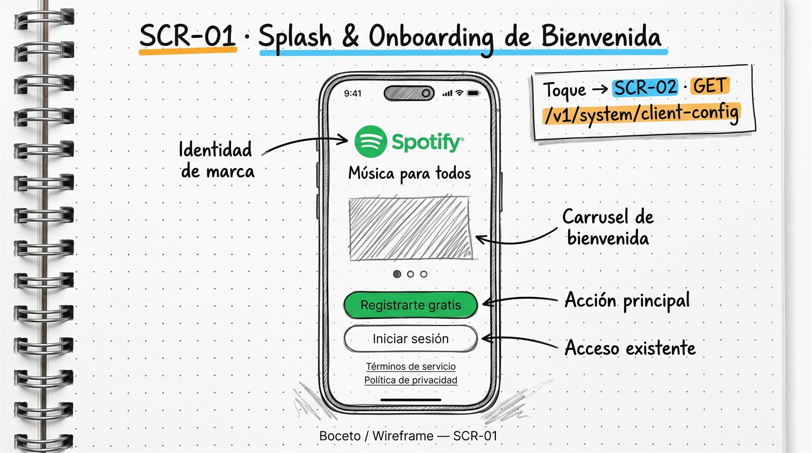</a>
       <b>SCR-01</b> · Splash &amp; Onboarding de Bienvenida
    </td>
    <td width="50%" align="center">
      <a href="./sketches/sketch2.jpg">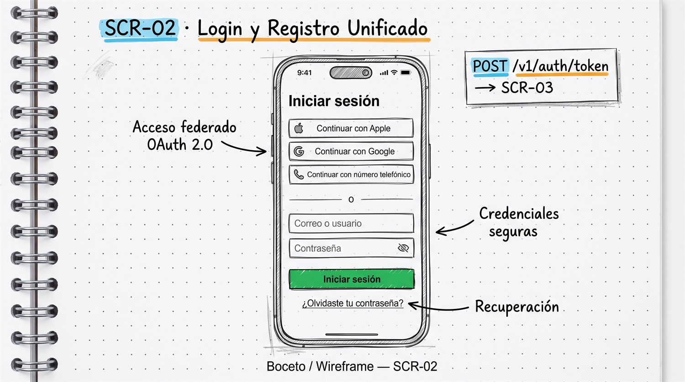</a>
       <b>SCR-02</b> · Login y Registro Unificado
    </td>
  </tr>
  <tr>
    <td width="50%" align="center">
      <a href="./sketches/sketch3.jpg">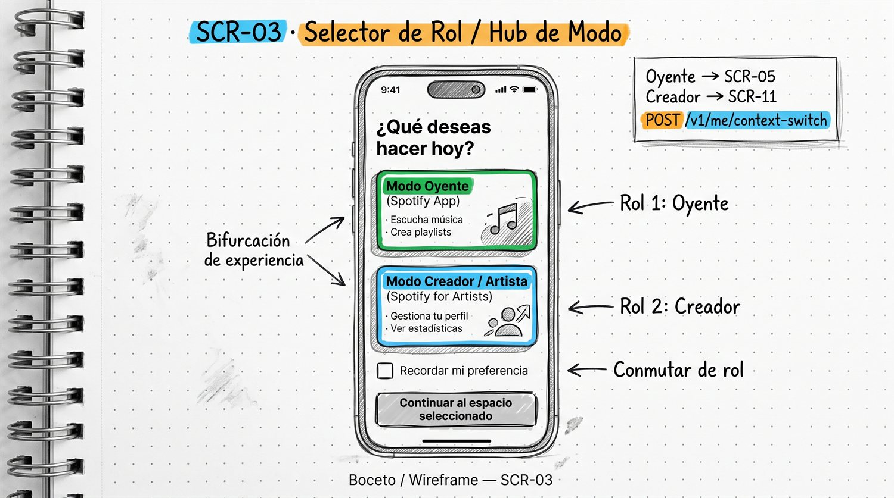</a>
       <b>SCR-03</b> · Selector de Rol / Hub de Modo
    </td>
    <td width="50%" align="center">
      <a href="./sketches/sketch4.jpg">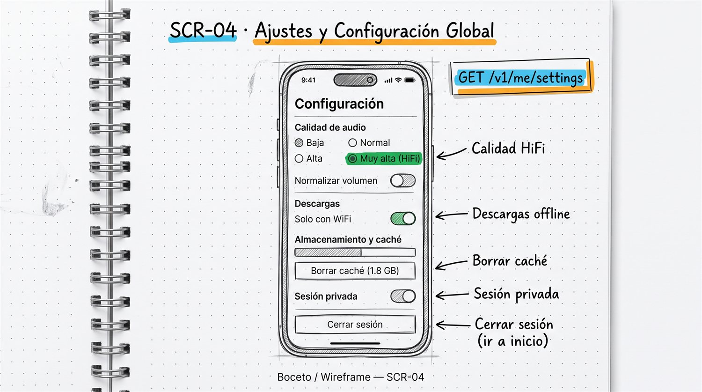</a>
       <b>SCR-04</b> · Ajustes y Configuración Global
    </td>
  </tr>
</table>

<h3 align="center">🎧 Rol 1: Usuario Oyente (Listener / Fan)</h3>

<table>
  <tr>
    <td width="50%" align="center">
      <a href="./sketches/sketch5.jpg">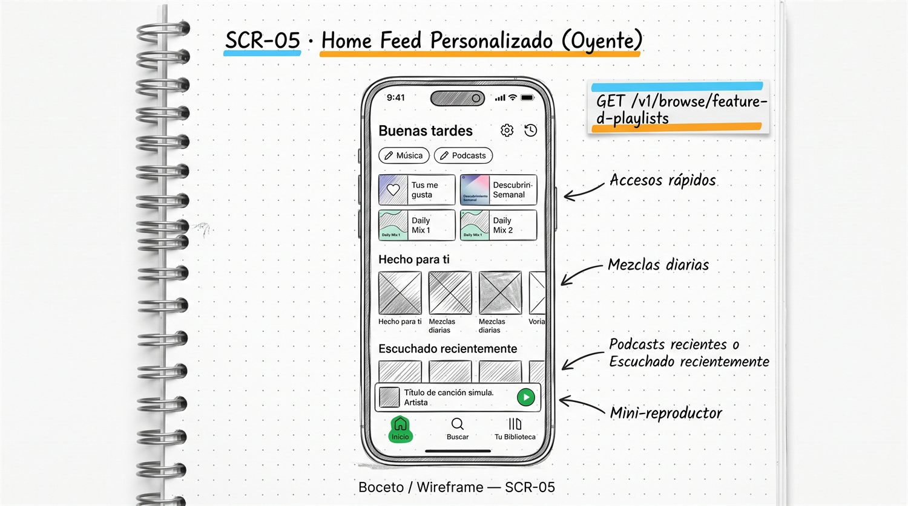</a>
       <b>SCR-05</b> · Home Feed Personalizado
    </td>
    <td width="50%" align="center">
      <a href="./sketches/sketch6.jpg">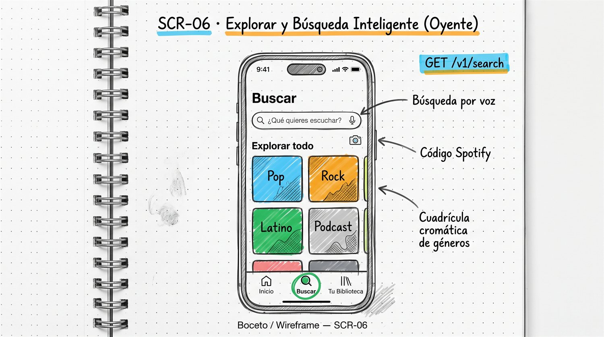</a>
       <b>SCR-06</b> · Explorar y Búsqueda Inteligente
    </td>
  </tr>
  <tr>
    <td width="50%" align="center">
      <a href="./sketches/sketch7.jpg">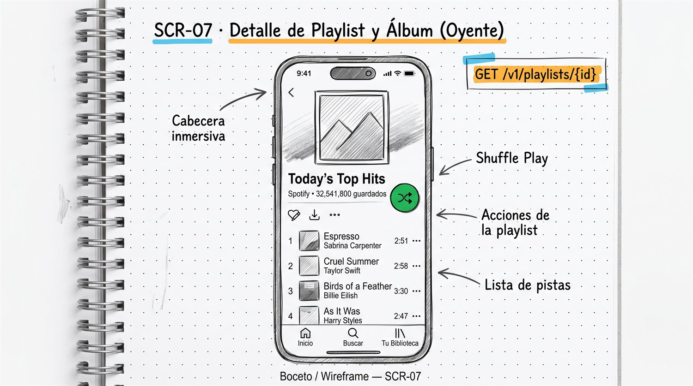</a>
       <b>SCR-07</b> · Detalle de Playlist y Álbum
    </td>
    <td width="50%" align="center">
      <a href="./sketches/sketch8.jpg">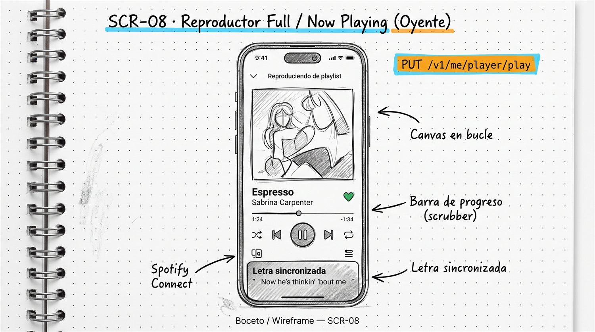</a>
       <b>SCR-08</b> · Reproductor Full (Now Playing)
    </td>
  </tr>
  <tr>
    <td width="50%" align="center">
      <a href="./sketches/sketch9.jpg">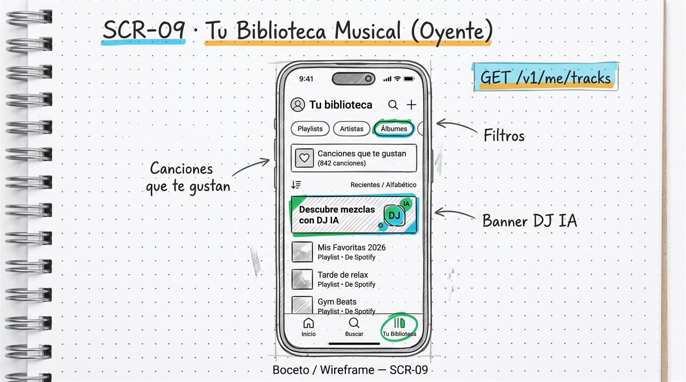</a>
       <b>SCR-09</b> · Tu Biblioteca Musical
    </td>
    <td width="50%" align="center">
      <a href="./sketches/sketch10.jpg">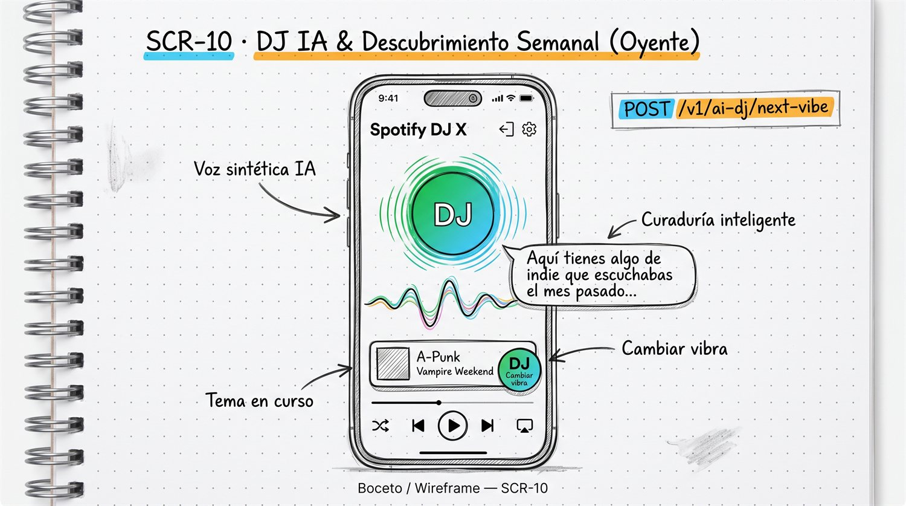</a>
       <b>SCR-10</b> · DJ IA &amp; Descubrimiento Semanal
    </td>
  </tr>
</table>

<h3 align="center">🎤 Rol 2: Creador / Artista (Spotify for Artists)</h3>

<table>
  <tr>
    <td width="50%" align="center">
      <a href="./sketches/sketch11.jpg">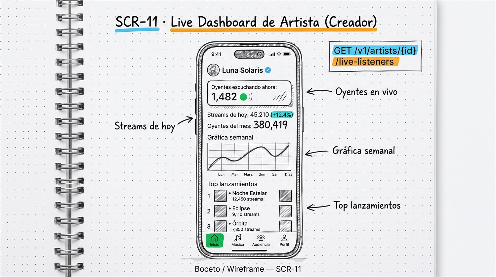</a>
       <b>SCR-11</b> · Live Dashboard de Artista
    </td>
    <td width="50%" align="center">
      <a href="./sketches/sketch12.jpg">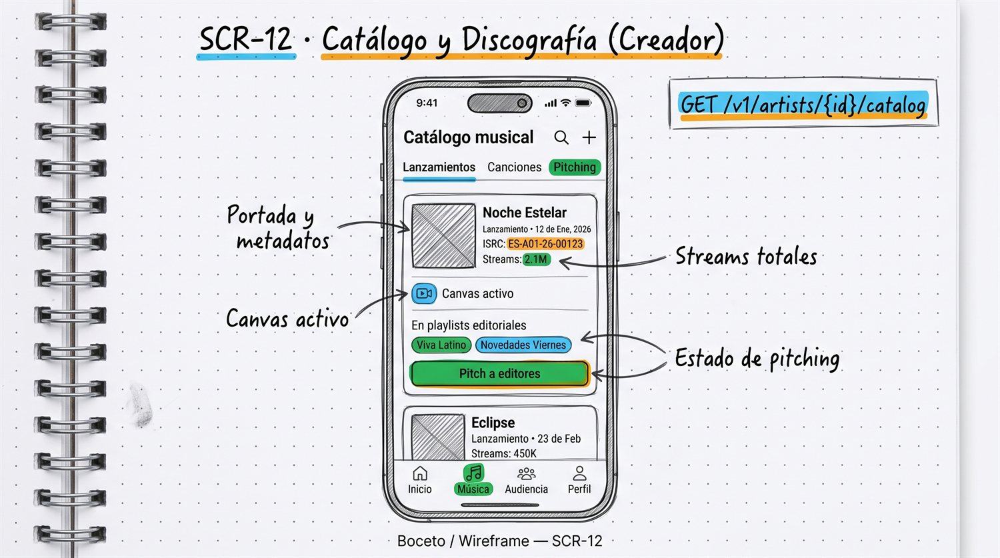</a>
       <b>SCR-12</b> · Catálogo y Discografía
    </td>
  </tr>
  <tr>
    <td width="50%" align="center">
      <a href="./sketches/sketch13.jpg">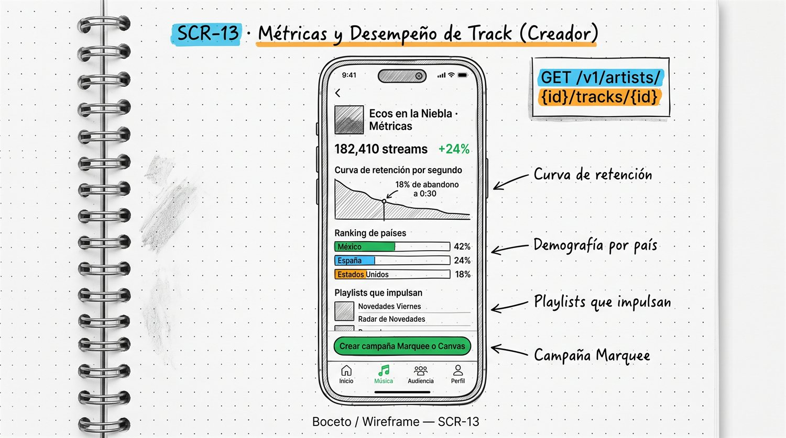</a>
       <b>SCR-13</b> · Métricas y Desempeño de Track
    </td>
    <td width="50%" align="center">
      <a href="./sketches/sketch14.jpg">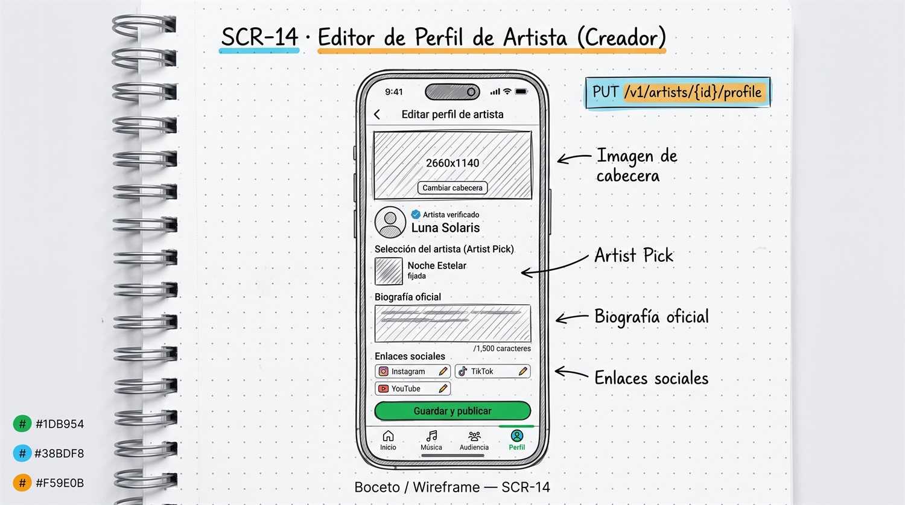</a>
       <b>SCR-14</b> · Editor de Perfil de Artista
    </td>
  </tr>
  <tr>
    <td width="50%" align="center">
      <a href="./sketches/sketch15.jpg">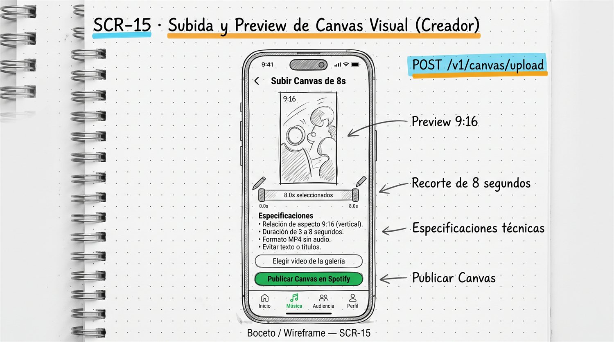</a>
       <b>SCR-15</b> · Subida y Preview de Canvas Visual
    </td>
    <td width="50%" align="center">
      <a href="./sketches/sketch16.jpg">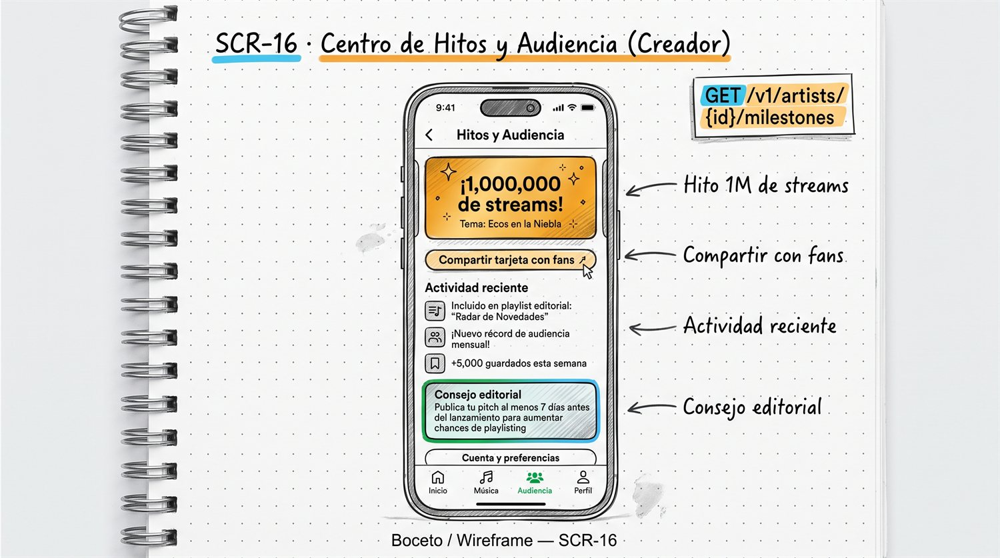</a>
       <b>SCR-16</b> · Centro de Hitos y Audiencia
    </td>
  </tr>
</table>

> 📁 Los archivos en máxima resolución se conservan en [`sketches/originales/`](./sketches/originales/) (16 × ~2.5 MB); la carpeta [`sketches/`](./sketches/) contiene las versiones optimizadas (~180 KB c/u) usadas en esta galería.

---

## 🏗️ Diagrama Interactivo de Arquitectura de Pantallas

La especificación formal del diagrama fue validada con la CLI de Archify bajo el perfil estricto `showcase`. Los comandos `archify validate` y `archify check` reportan `status: pass` con **0 errores y 0 advertencias**, garantizando:
- **0 cruces de líneas (*proper crossings: 0*)**
- **0 colisiones ni rutas de etiquetas contra componentes (*label route clearance issues: 0*)**
- **0 microsegmentos ilegibles (*micro segment count: 0*)**
- **Legibilidad desktop garantizada (*min projected font: 6.18px >= 6.0px*)**

> ℹ️ El diagrama es un documento HTML **interactivo y desplazable** (incluye leyenda, tarjetas y *dock* de herramientas), por lo que su altura puede exceder un viewport único de 900 px en resoluciones estándar; la lectura óptima es a partir de **2048×1320**.

  <a href="https://jesuuusart.github.io/Practicas_INTEGRADORA_220772/Practica06/">
    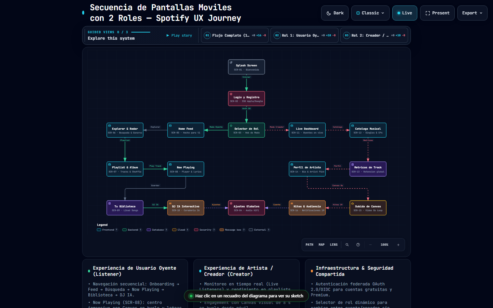
  </a>
  
<em>Haz clic en la imagen para abrir el diagrama interactivo en GitHub Pages.</em>

### 🖱️ Interacción principal: clic en un recuadro → ventana con el sketch

Los **16 componentes del diagrama son clicables**. Al pulsar cualquiera de ellos se abre una **ventana emergente (modal)** que muestra la **imagen del sketch** de esa pantalla (archivo `sketches/sketchN.jpg`), junto con su **ficha técnica**: objetivo UX, disparador de interacción y endpoint de la API de Spotify. La ventana se cierra con la ✕, con la tecla `Esc` o al hacer clic en el fondo.

Además, cada recuadro acepta *deep-links* directos, por ejemplo `spotify-screens.html#sketch=scr-08`, útil para compartir o para abrir la revisión de una pantalla concreta.

  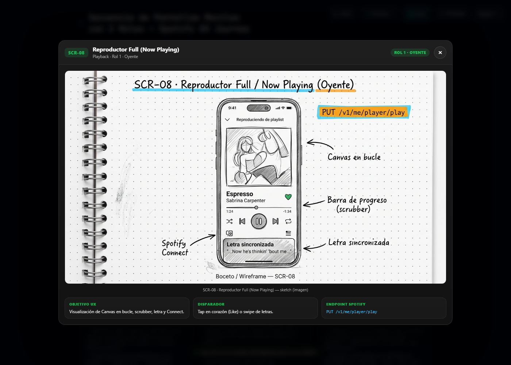
  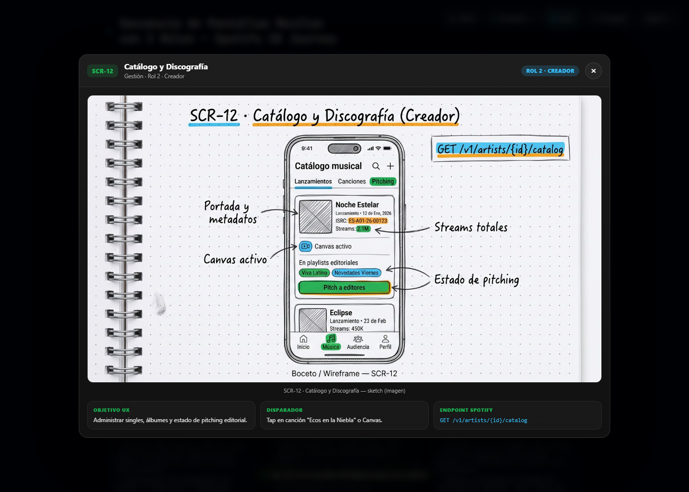
  
<em>Ejemplos reales: al hacer clic en <b>SCR-08</b> (Reproductor Full, Oyente) y en <b>SCR-12</b> (Catálogo y Discografía, Creador) se despliega la ventana con el sketch de cada pantalla.</em>

---

## 🖼️ Evidencias Visuales (Capturas del Diagrama)

### 1. Captura 1440x900 (Modo Oscuro Oficial Spotify #121212)

  

### 2. Captura 1440x900 (Modo Claro)

  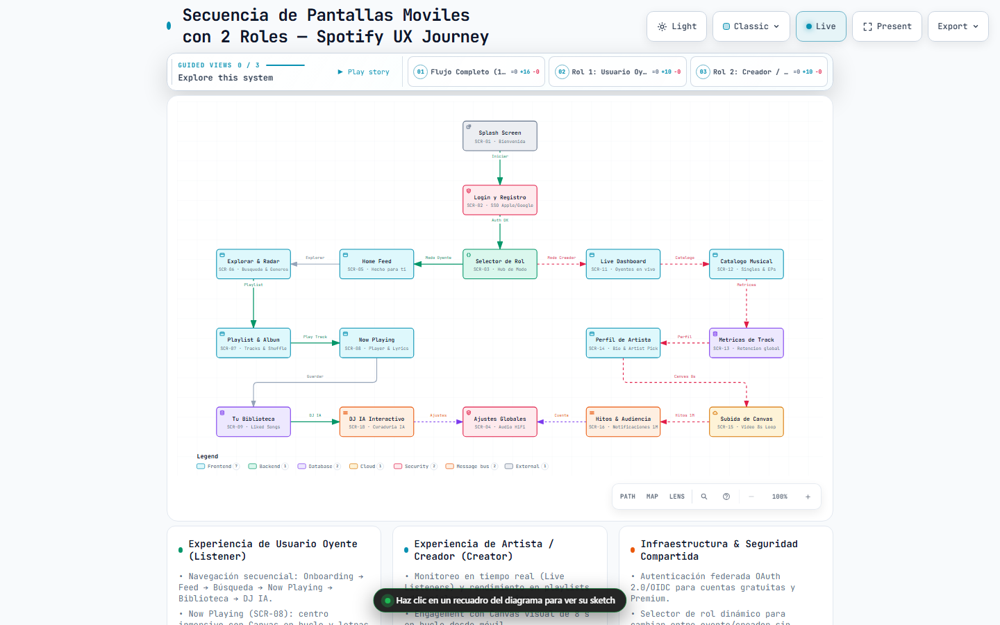

### 3. Captura 2048x1320 Retina (Modo Oscuro)

  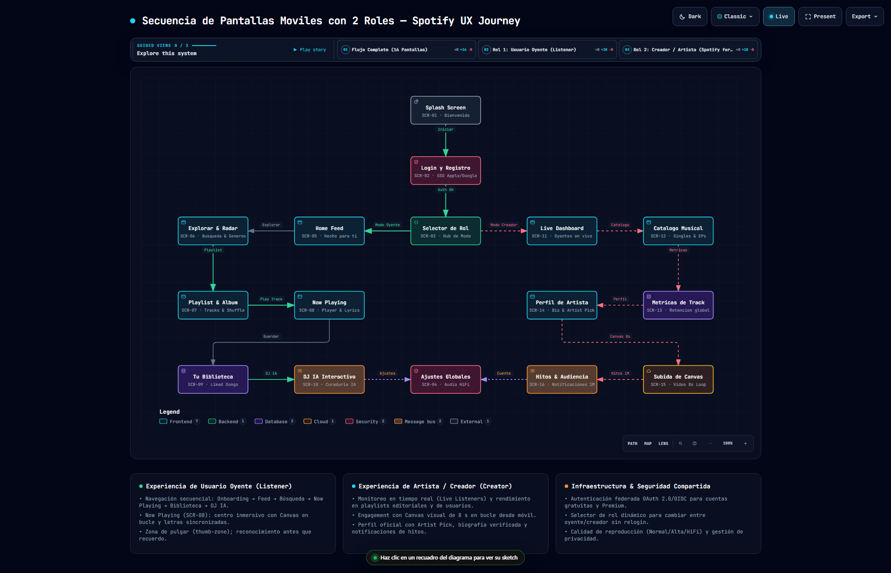

### 4. Captura 2048x1320 Retina (Modo Claro)

  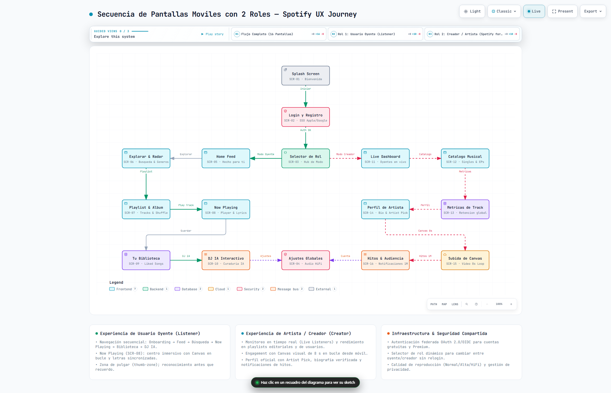

---

## 🛠️ Tecnologías y Herramientas Utilizadas

- **Archify 2.17 CLI**: Generación y validación formal del diagrama arquitectónico de flujo (`archify validate`, `archify render`, `archify check`, `archify visual-check`).
- **Node.js**: Script de compilación y postprocesamiento reproducible (`tools/build-screens.mjs`).
- **SVG Vectorial**: Diagrama de flujo de pantallas renderizado como SVG vectorial por Archify, con marcos de smartphone y estilo de marca Spotify (#1DB954 / #121212 / #38BDF8).
- **Sketchboards Ilustrados (JPG)**: Bocetos de cuaderno en español para cada pantalla (16), optimizados automáticamente para carga web (≤ 200 KB c/u).
- **HTML5, Vanilla CSS3 y JavaScript ES6**: Capa interactiva propia sobre el diagrama: delegación de eventos sobre los nodos (`[data-node-id]`), **modal de sketch** con la imagen de cada pantalla, ficha técnica, cierre por `Esc`/fondo y *deep-link* (`#sketch=scr-NN`).
- **Git & GitHub Pages**: Control de versiones en rama dedicada `practica06` y despliegue público en la nube.

---

## 🔄 Flujo de Trabajo y Prompts Iterados

La práctica siguió el ciclo de mejora continua solicitado por el docente, documentado en archivos `.txt`:
1. [prompt-v1.txt](./prompt-v1.txt): Solicitud inicial de secuencia de pantallas de Spotify móvil con 2 roles y catálogo básico.
2. [prompt-v2.txt](./prompt-v2.txt): Refinamiento formal de carriles (*lanes*), fases temporales (*phases*) y numeración de las 16 pantallas.
3. [prompt-v3.txt](./prompt-v3.txt): Especificación definitiva con paleta de marca Spotify (#1DB954, #121212, #38BDF8), restricciones de layout, simulador móvil y heurísticas de usabilidad.

---

## 📌 Conclusión

La Práctica 06 consolidó el modelado de experiencia de usuario en aplicaciones móviles complejas, articulando dos dimensiones de una misma plataforma: el consumo multimedia para el **oyente** y la gestión de negocio y métricas para el **creador**. El uso del agente **Archify** junto con una arquitectura de código reproducible, sketches ilustrados en español y una capa interactiva en la que **al hacer clic en cada recuadro del diagrama se despliega la imagen de su sketch** permitió transformar requerimientos funcionales en una solución visual profesional, interactiva y lista para revisión.
